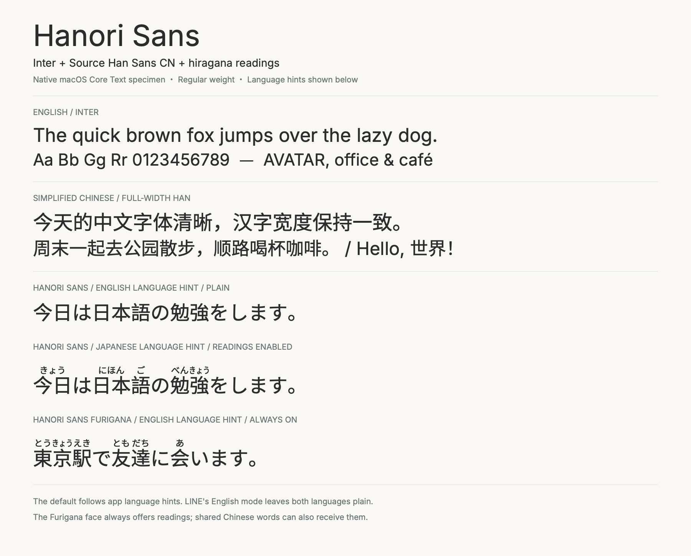
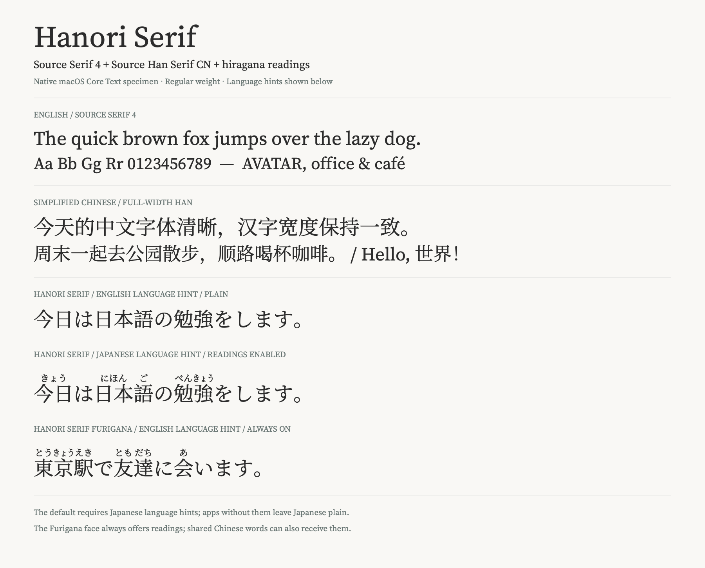
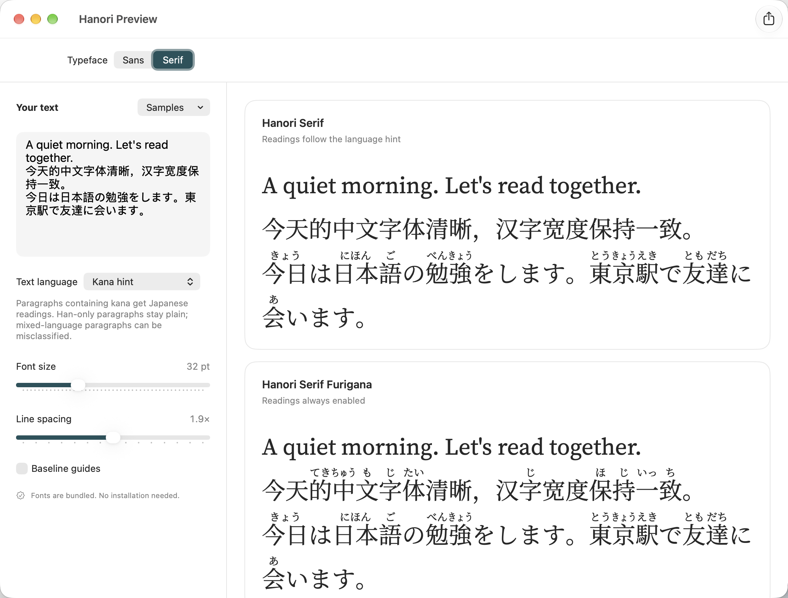
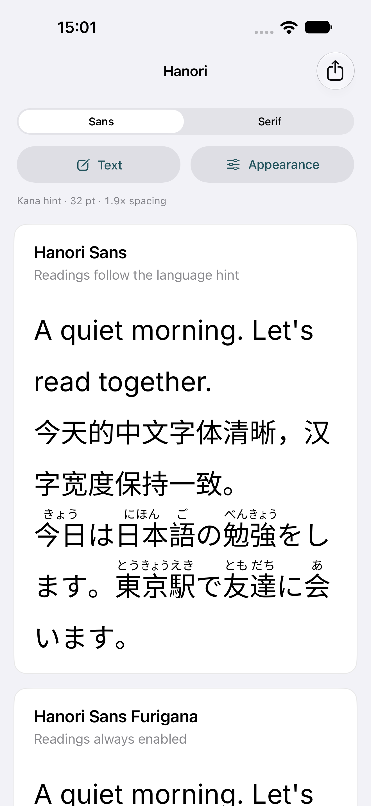
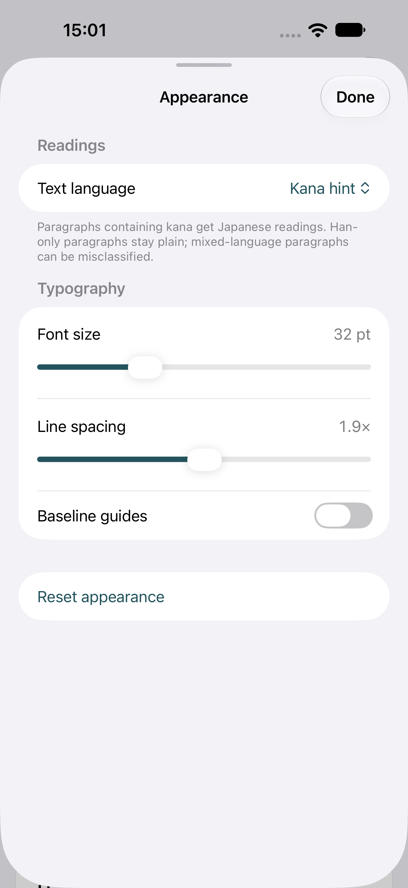

# Hanori 0.1.3

Fonts for English, Simplified Chinese, and Japanese reading, with **Sans** and
**Serif** designs and optional built-in furigana.

## Why Hanori?

Hanori started with a problem in LINE on macOS: keeping LINE's interface in
English could give Chinese messages unwanted Japanese glyph forms and uneven
spacing. Selecting Hanori as the app's font addresses that without changing the
interface language:

- **Chinese forms across app languages.** Covered Han characters keep their
  Chinese shapes even when the app supplies English or Japanese language hints.
- **Consistent Chinese spacing.** Han characters retain full-width advances.
- **English that fits alongside CJK text.** Latin letters and kerning come from
  Inter or Source Serif 4.
- **Japanese reading help.** Furigana comes from the font without changing the
  underlying message or adding ruby markup.

Install the font, then select it in apps that support custom fonts to apply these
choices. Shared Han characters also use Chinese forms in Japanese text;
simplified/traditional writing stays as typed.

## Choose a font

| Family | Composition | Automatic readings |
| --- | --- | --- |
| Hanori Sans | Inter + Source Han Sans CN | Japanese language hints only |
| Hanori Sans Furigana | Same Sans design | Always enabled |
| Hanori Serif | Source Serif 4 + Source Han Serif CN | Japanese language hints only |
| Hanori Serif Furigana | Same Serif design | Always enabled |

All four are static Regular-weight OpenType fonts in [`dist/`](dist/).

<details>
<summary>Font specimens</summary>





</details>

## Try on macOS

1. Install the desired `.otf` files from `dist/` with Font Book.
2. Quit and reopen the target app, then choose **Hanori Sans** or **Hanori Serif**.
   Choose the corresponding **Furigana** family for always-on readings.

In Chrome or Edge, use either design for Standard, **Hanori Serif** for Serif, and
**Hanori Sans** for Sans-serif. Keep your existing fixed-width font. Websites can
still request their own fonts.

## Preview on iOS and macOS


Run `npm run app` on macOS, or open
[`app/HanoriPreview.xcodeproj`](app/HanoriPreview.xcodeproj) in Xcode for iOS.
The app bundles all four fonts and supports iOS 17+ and macOS 14+; no font
installation is needed. Other iOS apps need their own custom-font support.

**macOS** — edit text and compare both reading modes with the controls in the sidebar.



**iOS** — the font preview and its Appearance sheet.

<p>
  
  
</p>

Edit text, compare reading modes, adjust language hints and typography, and export
PNG specimens. See [`app/README.md`](app/README.md) for controls, kana hints, and
device testing.

## Furigana behavior

Default faces need the app to supply a Japanese language hint. Our English-mode
LINE trial left Japanese plain; choose a **Furigana** face for readings there.
Always-on readings can also annotate Chinese words that match the Japanese dictionary.

Readings may be wrong. Leave room above the text—roughly 1.6–1.7× line height is a
starting point. Vertical furigana is unsupported; emoji and rare missing characters
use the app's fallback fonts.

## Build and verification

Requires Node.js 22.18+ and npm. Native app checks additionally require Xcode.

```sh
npm ci --ignore-scripts
npm run build
npm test

# macOS: Core Text composition and renderer tests.
npm run verify:native
```

The TypeScript pipeline uses pinned inputs and reproducible timestamps. Tests
check Chinese outlines and spacing, Latin metrics and kerning, language-dependent
readings, and native rendering. Reports are in `dist/`; architecture and development
commands are in [`AGENTS.md`](AGENTS.md).

## Credits and licensing

- Fonts: [Inter](https://github.com/rsms/inter), [Source Serif 4](https://github.com/adobe-fonts/source-serif),
  [Source Han Sans](https://github.com/adobe-fonts/source-han-sans), and
  [Source Han Serif](https://github.com/adobe-fonts/source-han-serif) — SIL OFL 1.1.
- [FuriFont](https://github.com/antfu/furifont), by Anthony Fu: MIT code; derived fonts under SIL OFL 1.1.
- Dictionary readings and rules: CC BY-SA 4.0; see
  [dictionary attribution](licenses/Dictionary-CC-BY-SA.md).

Preserve the included licenses and attributions when sharing these files.
